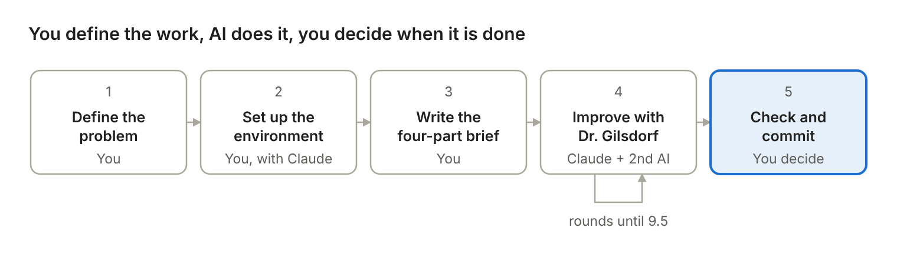

# The Panaversity AI Method

The **Panaversity AI Method** is the way Panaversity's own team works with AI, and the way you work through every step of this bootcamp. The book describes it in [How the Panaversity team works](https://agentfactory.panaversity.org/claude-and-chatgpt-2/new-way-of-working/how-the-panaversity-team-works/#what-is-the-panaversity-ai-method). This page shows where each of its five steps happens here.

<picture>
  <source media="(prefers-color-scheme: dark)" srcset="../assets/panaversity-ai-method-dark.png">
  <source media="(prefers-color-scheme: light)" srcset="../assets/panaversity-ai-method-light.png">
  
</picture>

One idea sits under all five steps: **AI does most of the work, and a person decides what the work is for and when it is done.** In this bootcamp, that person is you.

## The five steps in this bootcamp

| Step | What it means | Where you do it here |
| --- | --- | --- |
| **1. Understand and define the problem** | Decide what you want, why it matters and how you will know it is done. | Before you start a step, read Stockroom's ask, **What you will build** and the **Submission checklist**: they are the problem and the "done" test. In the step 21 capstone, you define the problem yourself. |
| **2. Set up the environment** | A safe place for the work that keeps every version, with Claude given only the access it needs. | Once, in [Step 00](../step-00-readiness-check/README.md) and [How we work](../README.md#how-we-work-local-first-human-in-the-loop) items 1 to 6: your fork, your local clone, a Claude project with the folder and the fork, "never commit or push" in its instructions, least access, and bootcamp-only Cloudflare, Neon and Stripe accounts. Then a new thread for each step. |
| **3. Write the four-part brief** | Outcome, context, format and constraints, with the checks the work must pass. | Each step's prompts under **Build it with Claude Code** are briefs written for you. Read each one before you paste it, so you know what "done" means. In the capstone, you write your own. |
| **4. Improve the work with the Dr. Gilsdorf method** | Grade and improve the work in rounds toward 9.5 out of 10, run the checks, and get an independent review from a second AI. | Before you commit each step, use the prompt below. The step's tests and checklist are the pass-or-fail checks. For milestone steps (4, 8, 10, 15, 18 and 21), ask a second AI to review your code too. |
| **5. Check and commit** | A person checks the final result, approves it and saves it as the official version. | Test the deployed server in Claude and ChatGPT, read the diff in GitHub Desktop, then commit, tag `step-NN-done` and push it yourself. Write what you learned in the step's `NOTES.md`, and submit as [SUBMITTING.md](../SUBMITTING.md) says. |

## The environment

You set it up once, in Step 00. Claude edits the files in your local folder, and you commit them; a cloud session works on its own branch, which you review.

<picture>
  <source media="(prefers-color-scheme: dark)" srcset="../assets/panaversity-ai-method-environment-dark.png">
  <source media="(prefers-color-scheme: light)" srcset="../assets/panaversity-ai-method-environment-light.png">
  
</picture>

## Rules that never change

- **Claude never commits or pushes.** You read every change in GitHub Desktop and commit it yourself. That is the human in the loop.
- **A rule in a prompt is not a permission.** Give Claude the least access the step needs: routine commands under narrow permissions, and anything sensitive or irreversible approved by you ([How we work](../README.md#how-we-work-local-first-human-in-the-loop), item 6).
- **Tests outrank grades.** A 9.8 never makes up for a failed test. A cross-tenant leak fails the step, whatever the grade says.
- **Secrets stay secret.** Keys live in `.dev.vars` and `wrangler secret put`, never in a prompt, a chat or the repo. A second AI gets only your code, never keys, `.dev.vars` or client data.
- **Your work stays in your fork.** Never open a pull request to the bootcamp repo.

## A prompt for the end of each step

Paste this into the step's thread when the build is done, before you commit:

```text
Before I commit this step, run its tests and go through its submission checklist item by item. Then grade the work out of 10 in three areas: correctness, security and tenant isolation, and clarity of the code for a reader. Give the evidence for each grade. A failed test or checklist item counts for more than any grade. Improve the work in small rounds until every test passes and each area reaches 9.5, for at most three rounds, and then list anything still open. Never commit or push.
```

For a milestone step, then give your code (never `.dev.vars` or keys) to a second AI, such as ChatGPT, and ask it to review and grade the same three areas, with specific fixes and evidence. Don't show it Claude's grades. Paste its review back into the thread and ask Claude to weigh each point, fix what is right, and run the tests again.

## References

From [The AI Agent Factory](https://agentfactory.panaversity.org/), the book this bootcamp accompanies:

- [How the Panaversity team works](https://agentfactory.panaversity.org/claude-and-chatgpt-2/new-way-of-working/how-the-panaversity-team-works/): the full description of the method, with its diagrams.
  - ["What is the Panaversity AI Method?"](https://agentfactory.panaversity.org/claude-and-chatgpt-2/new-way-of-working/how-the-panaversity-team-works/#what-is-the-panaversity-ai-method): the five steps and when to use each.
  - ["Where does the work live?"](https://agentfactory.panaversity.org/claude-and-chatgpt-2/new-way-of-working/how-the-panaversity-team-works/#where-does-the-work-live): the repository, the Claude project and committing by hand.
  - ["How do we improve the work?"](https://agentfactory.panaversity.org/claude-and-chatgpt-2/new-way-of-working/how-the-panaversity-team-works/#how-do-we-improve-the-work): the Dr. Gilsdorf method, step by step.
- [Appendix: versions and pull requests](https://agentfactory.panaversity.org/appendices/claude-and-chatgpt-2/appendix-versions-and-pull-requests/): why a person reads every change before it is kept.

---

[Back to the bootcamp README](../README.md#how-we-work-local-first-human-in-the-loop)
